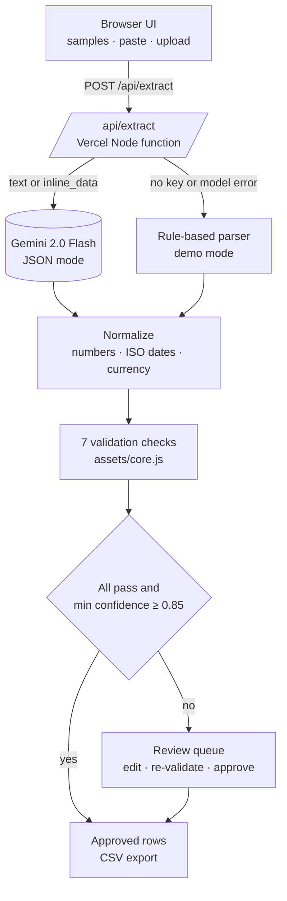

<div align="center">

<h1>Invoice &amp; Document Extractor</h1>

<p>Turn an invoice, bill or receipt into validated JSON, then auto-approve it or send it to a person, with the reason attached.</p>

<p>
  <a href="https://invoice-extractor.vercel.app"></a>
  <a href="n8n/invoice-extractor.n8n.json"></a>
  <a href="LICENSE"></a>
  
  
</p>

<p>
  <a href="https://invoice-extractor.vercel.app"><b>Live demo</b></a> ·
  <a href="#n8n-workflow"><b>n8n workflow</b></a> ·
  <a href="#how-it-works"><b>Architecture</b></a> ·
  <a href="#run-locally"><b>Run locally</b></a>
</p>

</div>

## Overview

Accounts payable teams still retype invoices, and the expensive mistakes are a total that does not add up, a duplicate bill, or a changed bank account. This app extracts every field with its own confidence score, checks the arithmetic, dates and duplicates in code, and only auto-approves when everything passes and every field is at or above 0.85. Everything else goes to a review queue where a person fixes the fields and approves, and approved rows export as CSV.

## Highlights

- **Clean JSON contract.** Vendor, tax ID, bill-to, invoice number, dates, currency, line items, subtotal, tax lines (CGST, SGST, UTGST, IGST, VAT, sales tax), total and payment terms.
- **Confidence per field.** One unclear date sends an invoice to review, and the reviewer sees which fields to confirm.
- **Seven checks in code.** Required fields, line arithmetic, lines = subtotal, tax breakdown, subtotal + tax = total, due after issue, duplicate vendor + number in the session.
- **Review queue.** Edit any field, line or tax line; checks re-run as you type. Failing checks need a second click to approve.
- **Four one-click samples.** Indian GST invoice, US SaaS invoice, OCR-noisy receipt, and a suspicious invoice with a sum mismatch.
- **Works without keys.** Demo mode uses a rule-based parser on the same JSON contract; add a Gemini key to read PDFs and images.

## How it works



1. The browser sends the text, or the file as base64, plus the duplicate keys seen this session to `POST /api/extract`.
2. With `GEMINI_API_KEY` set, the server asks Gemini 2.0 Flash for strict JSON and per-field confidence. The prompt tells it to copy numbers as printed and never recompute them.
3. `normalizeInvoice` coerces the answer into the contract. Missing confidence counts as 0.5, so an incomplete answer goes to review.
4. `validate` and `route` in `assets/core.js` run the checks and decide `auto_approve` or `review`. The browser reuses the same module to re-validate edits in the review queue.
5. Approved rows, the queue and the duplicate history live in localStorage. Export writes a CSV with formula-safe cells.

## Business impact

Estimated only. Illustrative assumptions, not measured results.

| Assumption | Estimate |
| --- | --- |
| Volume | 500 invoices a month |
| Manual entry | about 5 minutes each, roughly 42 hours a month |
| Auto-approved share | 70 percent, if documents are mostly clean and digital |
| Review time for the rest | about 1 minute each, roughly 2.5 hours a month |
| Errors caught before payment | arithmetic, date order and duplicate checks on every invoice |

Replace these with your own volumes and timings before using them in a business case.

## Tech stack

| Layer | Tools |
| --- | --- |
| Frontend | Static HTML, CSS, vanilla ES modules, no build step |
| API | Vercel Node serverless functions (ESM, zero runtime dependencies) |
| Model | Gemini 2.0 Flash REST, JSON mode, inline_data for PDF and images |
| Logic | Pure validation and routing module shared by browser and server |
| Automation | n8n: Gmail Trigger, HTTP Request, Code, IF, Google Sheets, Slack |
| Tests | `node:test`, GitHub Actions on Node 20 |

## Project structure

```
invoice-extractor/
├── index.html               UI shell
├── assets/
│   ├── app.js               client: samples, upload, result tabs, review queue, CSV
│   ├── core.js              normalize, 7 checks, routing, duplicate key, CSV (shared)
│   ├── samples.js           four built-in sample documents
│   └── style.css
├── api/
│   ├── extract.js           POST /api/extract: guards, Gemini call, demo fallback
│   ├── status.js            GET /api/status: live or demo
│   └── _demo.js             rule-based parser with OCR repair (not a route)
├── n8n/invoice-extractor.n8n.json
├── scripts/dev-server.mjs   zero-dependency local server
├── test/                    core, demo parser, API and n8n tests
└── .github/workflows/ci.yml
```

## Run locally

```bash
git clone https://github.com/Saitarun29/invoice-extractor
cd invoice-extractor
npm run dev        # http://localhost:3000, demo mode, no keys needed
npm test
```

For live mode, start it with `GEMINI_API_KEY=your-key npm run dev`.

## Configuration

| Variable | Required | Purpose |
| --- | --- | --- |
| `GEMINI_API_KEY` | No | Enables live extraction and PDF or image uploads. Without it the app runs in demo mode. |
| `MODEL_TIMEOUT_MS` | No | Model call timeout, default 25000. Text falls back to demo mode on timeout. |
| `RATE_LIMIT_PER_MIN` | No | Requests per IP per minute per instance, default 20. |

Limits: text up to 20,000 characters, uploads up to 3 MB (PDF, PNG, JPEG, WebP), POST only.

## n8n workflow

[`n8n/invoice-extractor.n8n.json`](n8n/invoice-extractor.n8n.json): Gmail Trigger → Prepare attachment → Extract (Gemini) → Validate (Code) → Auto-approve? → Append to Sheets, or Slack review.

1. In n8n, choose **Import from file** and select the JSON.
2. Set `GEMINI_API_KEY`, `INVOICE_SHEET_ID`, `SLACK_REVIEW_CHANNEL` and optionally `INVOICE_SHEET_TAB` (default `Invoices`) and `INVOICE_CONFIDENCE_FLOOR` (default 0.85) as environment variables.
3. Attach your Gmail, Google Sheets and Slack credentials to their nodes. None are embedded.
4. Add a header row to the sheet matching the mapped columns, then activate. Duplicate keys persist in workflow static data on production executions.

## Deploy

[](https://vercel.com/new/clone?repository-url=https://github.com/Saitarun29/invoice-extractor)

Import the repo, optionally add `GEMINI_API_KEY`, and deploy. No build step.

<div align="center">

Built by **Sai Tarun Ronanki** · AI Systems & Agentic Workflows Builder · Hyderabad

[saitarun.com](https://saitarun.com) · [LinkedIn](https://linkedin.com/in/ronanki-sai-tarun) · [X](https://x.com/SaiTarunRonanki)

**[Discuss your workflow →](https://wa.me/918008941430?text=Hello%20Sai%20Tarun%20Ronanki,%20I%20want%20to%20discuss%20about%20my%20workflow)**

MIT © 2026 Sai Tarun Ronanki

</div>
